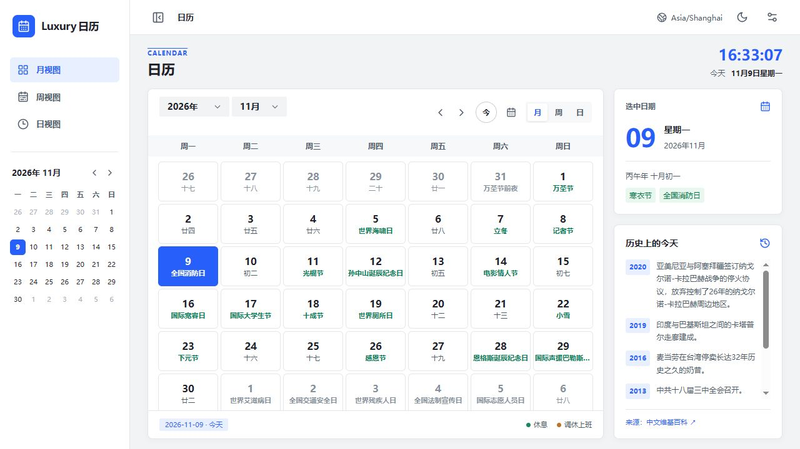

# Luxury日历

基于 Vue 3、Arco Design Vue、Tailwind CSS 和 Temporal 的日期查询日历。

项目提供网页端和 [uTools 插件](utools/README.md)。

## 网页端截图



## 网页端开发

```sh
npm install
npm run dev
npm test
npm run build
```

开发服务器地址以终端输出为准，构建产物位于 `dist/`。

## uTools 端

在 `utools/` 目录安装依赖并构建：

```sh
cd utools
npm install
npm test
npm run build
```

在 uTools 开发者工具中选择 `utools/dist/plugin.json` 接入插件，然后搜索「日历」「农历」或 `calendar` 使用。插件的设置与网页端分别保存在各自的 localStorage 中，不会自动同步。更多说明见 [uTools 插件 README](utools/README.md)。

## 功能与数据来源

支持月、周、日视图、农历、节气、节假日调休、历史上的今天，以及所选日期与今天的日历天数差。支持时区、周起始日、预设或自定义主色、明暗主题；为保证可读性，主色在当前模式中可能被自动调整，设置中会显示原色和实际颜色。日期详情、历史事件、侧边小日历、时区标识、农历与调休标记均可独立隐藏。设置保存在当前浏览器的 localStorage。旧版日程数据不会被读取或删除。

农历、节气和节日名称使用 lunar-javascript，界面支持 1900–2100 年；日期格优先显示节气或主要节日，选中日期可查看该库收录的其他纪念日，不能保证包含所有地方习俗。节假日调休数据由 [Hi8](https://hi8.com/t/jiejiari-api) 提供；2027 年还依据[国务院办公厅公告](https://www.gov.cn/zhengce/content/202611/content_7085101.htm)内置离线兜底。第三方未提供数据、返回空数据或网络不可用且没有内置数据时明确标注“数据未覆盖”，不推算调休安排；未标记的日期不代表一定上班。农历、节气及节假日按中国大陆日期显示。

历史事件来自中文维基百科，网络不可用时显示少量本地资料；第三方数据可能存在错误，重要信息请核对原始来源。请求只包含所选日期，不发送浏览器中保存的设置。

## 许可证

本项目采用 [MIT 许可证](LICENSE)。
